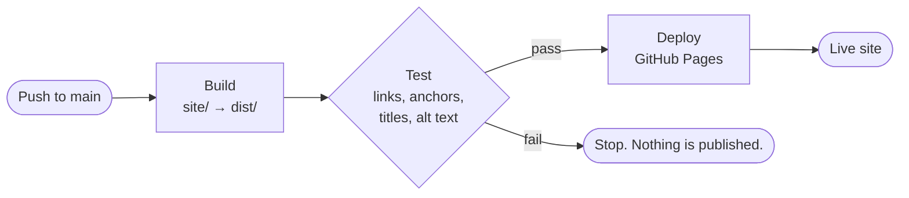

<div align="center">

# Pages Starter

**Push to `main`. Your site is live.**

A starter for plain HTML and CSS sites. GitHub Actions builds it, tests it and publishes it to GitHub Pages.

[](https://github.com/DA-bite/TEST/actions/workflows/deploy.yml)


[**Live site**](https://da-bite.github.io/TEST/) ·
[Getting started](https://da-bite.github.io/TEST/docs/getting-started/) ·
[How it works](https://da-bite.github.io/TEST/docs/pipeline/) ·
[FAQ](https://da-bite.github.io/TEST/docs/faq/)

</div>

---

## What you get

| | |
| --- | --- |
| **A finished site** | A landing page, a five-page documentation section and a 404 page, with light and dark themes. |
| **A pipeline that gates deploys** | Every push builds and tests the site. If a test fails, nothing is published. |
| **No dependencies** | Node 20 and the files in this repository. Nothing to install or keep updated. |
| **Works under any path** | Relative links keep the site working at `/repo/` on a project page and at the root of a custom domain. |
| **Accessible by default** | Visible keyboard focus, a skip link, reduced-motion support and checked color contrast. |
| **Self-hosted fonts** | Bricolage Grotesque and JetBrains Mono ship with the site, so visitors never contact a font server. |

## How it works



| Event | Build and test | Deploy |
| --- | :---: | :---: |
| Pull request to `main` | ✅ | ❌ |
| Push to `main` | ✅ | ✅ |
| Manual run from the Actions tab | ✅ | ✅ |

## Quick start

You need a **public** GitHub repository (Pages on private repositories needs a paid plan) and Git.

**1. Push the code**

```sh
git init -b main
git add .
git commit -m "Add site"
git remote add origin https://github.com/<user>/<repo>.git
git push -u origin main
```

**2. Turn on Pages**

Open **Settings → Pages**. Under **Build and deployment**, set **Source** to **GitHub Actions**.

> [!IMPORTANT]
> Skipping this step is the most common reason the first deploy fails. If the run already failed, open the **Actions** tab and choose **Re-run all jobs**.

**3. Open the site**

When the run turns green, the site is live at:

```
https://<user>.github.io/<repo>/
```

## Work on it locally

```sh
npm start        # build, then serve dist/ on your machine
npm run check    # build, then test
npm run build    # site/ → dist/
npm test         # check the pages in dist/
```

There is no watch mode. Run the build again after you edit a page.

## What's in the repository

```
.
├── site/                    Everything you publish
│   ├── index.html           Landing page
│   ├── 404.html
│   ├── docs/                Documentation pages
│   ├── partials/            Shared head, header, footer, docs menu
│   ├── fonts/               Self-hosted fonts and their licenses
│   ├── style.css            Design tokens and styles, light and dark
│   ├── main.js              Theme button, menu, copy buttons, contents list
│   └── favicon.svg
├── scripts/
│   ├── build.mjs            Copies site/ to dist/ and expands partials
│   └── test.mjs             Checks the built pages
├── .github/workflows/
│   └── deploy.yml           Build, test and deploy
└── package.json
```

## What the tests check

`npm test` reads every page in `dist/` and reports all problems at once.

- The required files exist: `index.html`, `404.html` and `.nojekyll`
- Each page has a doctype, a `lang` attribute, a charset, a viewport tag, a non-empty title and exactly one `<h1>`
- Ids are unique, and images have alt text
- Every relative link, image, stylesheet and script points to a file that exists
- Every `#anchor` points to a real id, including links into other pages
- No link starts with `/`, which would break on a project page
- No placeholders or include markers are left in the output

External links aren't fetched, so a flaky network never blocks a deploy.

## Make it yours

**Add a page.** Create `site/about/index.html`, start from any existing page and keep the three `@include` lines for the head, header and footer. Write internal links with the root placeholder, for example `{{root}}docs/faq/`. The build turns it into the right relative path for each page.

**Change the look.** The design tokens sit at the top of `site/style.css`. The dark theme repeats them in two places, one for visitors whose system prefers dark and one for the theme button, so change both.

**Use a custom domain.** Put your domain on one line in `site/CNAME`, then set it under **Settings → Pages**. No other change is needed.

**Use a site generator.** The workflow only needs `npm run build` to put the finished site in `dist/`. Swap in your generator's command, add an install step if it has dependencies, and the tests keep working.

The [customization guide](https://da-bite.github.io/TEST/docs/customization/) covers each of these in full.

## Troubleshooting

| Symptom | Fix |
| --- | --- |
| Run fails at **Configure Pages** | Set **Settings → Pages → Source** to **GitHub Actions**, then re-run |
| "Resource not accessible by integration" | Keep the `permissions` block in `deploy.yml` and check **Settings → Actions → General** |
| Deploy blocked by environment rules | In **Settings → Environments → github-pages**, allow the `main` branch |
| Page loads without styles | A link starts with `/`. Use the root placeholder instead |
| **Pages** is missing from Settings | Make the repository public, or use a plan that supports private Pages |

More fixes are in the [troubleshooting guide](https://da-bite.github.io/TEST/docs/troubleshooting/).

## Licenses

The code in this repository is yours to use and change. Add a `LICENSE` file that matches how you want to share it.

The fonts are licensed under the [SIL Open Font License 1.1](https://openfontlicense.org). The license files sit next to the fonts in [`site/fonts/`](site/fonts/).
